<picture>
  <source media="(prefers-color-scheme: dark)" srcset="assets/hero-dark.svg">
  
</picture>

# AI Enablement Kit

How UniReverse makes a client's team able to run and extend an AI workflow after our engineers leave, and how we assess readiness before the work starts.

**FDE stage 05 · Operate** · part of the [fde-playbook](https://github.com/Unireverse-ai/fde-playbook)

## What you get

- A readiness rubric, a 30-question questionnaire and a scoring script that report where a team is strong, where it is weak and what to fix first.
- Role-based enablement for five roles, with four session plans, practice tasks and sign-off criteria.
- Adoption and governance templates: metrics with exact definitions, a 90-day plan, an internal champion model, an acceptable-use policy and a change-control route.

## Quickstart

```
python readiness/score.py readiness/example-answers.json
```

Python 3.9 or later, standard library only. The output is [readiness/example-report.md](readiness/example-report.md). Run the tests with `python -m unittest discover -s tests -v`.

## How we use it in an engagement

- Stage 01: the business owner, with the workflow owner, answers the questionnaire; we score it and name the five roles and the champion.
- Stages 03–04: operators and reviewers join the build and label eval cases; sessions 01 and 02 run before go-live.
- Stage 05: sessions 03 and 04, practice tasks and sign-off per role; ownership passes to the champion on the 90-day plan.
- Day 90: the team re-answers the same questionnaire, and the results scope the next workflow.

## Roles

The kit names five roles. Each maps to a role in the [fde-playbook](https://github.com/Unireverse-ai/fde-playbook) engagement model. One person may hold several.

| Kit role | Playbook role |
|---|---|
| Executive sponsor | Business owner |
| Workflow owner | Operations owner |
| Daily operator / reviewer | Process experts |
| Internal builder / admin | System owner |
| IT & security | Data/system owner |

The readiness questionnaire is answered by the business owner, with the workflow owner. Role detail is in [enablement/roles.md](enablement/roles.md).

## Contents

| Path | What it is |
|---|---|
| [readiness/](readiness/README.md) | What readiness means, the [rubric](readiness/rubric.md), the [questionnaire](readiness/questionnaire.md), [score.py](readiness/score.py) |
| [enablement/](enablement/README.md) | The programme: who is trained, when and by whom; [roles](enablement/roles.md); [session plans](enablement/session-plans/01-reviewing-ai-output.md); [operator quick reference](enablement/operator-quick-reference.md) |
| [adoption/](adoption/README.md) | [Metrics](adoption/metrics.md), [90-day plan](adoption/90-day-plan.md), [champions](adoption/champions.md) |
| [governance/](governance/acceptable-use.md) | [Acceptable use](governance/acceptable-use.md) and [change control](governance/change-control.md) templates |
| [tests/](tests/test_score.py) | Unit tests for the scoring script |

Templates use `⟦...⟧` for fields filled in per engagement.

## Related

| Stage | Repository |
|---|---|
| Previous · 03–04 Build and Evaluate | [workflow-evals](https://github.com/Unireverse-ai/workflow-evals): control layer and eval harness |
| The method · 01–05 | [fde-playbook](https://github.com/Unireverse-ai/fde-playbook) |
| Next workflow · 02 Assess | [ai-value-assessment](https://github.com/Unireverse-ai/ai-value-assessment): value model and cash-flow method |

---

Sample data in this repository is illustrative. Client work stays in the client's environment.

Source and documents are provided for inspection; see [RIGHTS.md](RIGHTS.md).

UniReverse · Unireverse OÜ, Tallinn, Estonia · [unireverseai.com](https://unireverseai.com) · [Eric@unireverseai.com](mailto:Eric@unireverseai.com)
